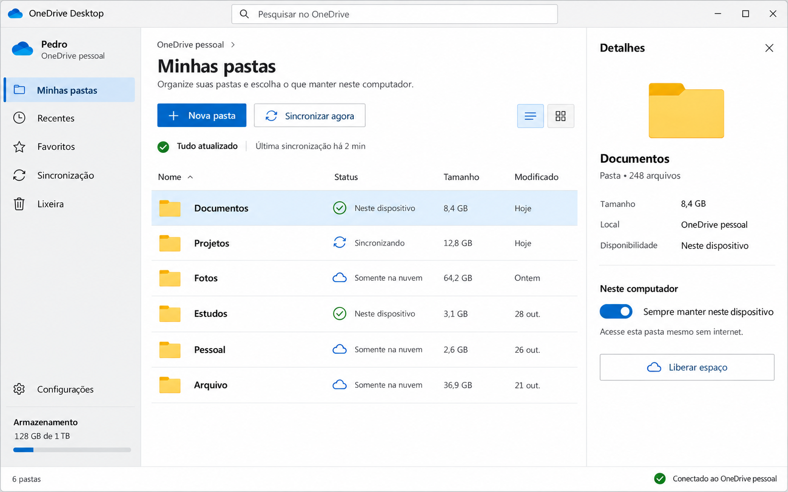
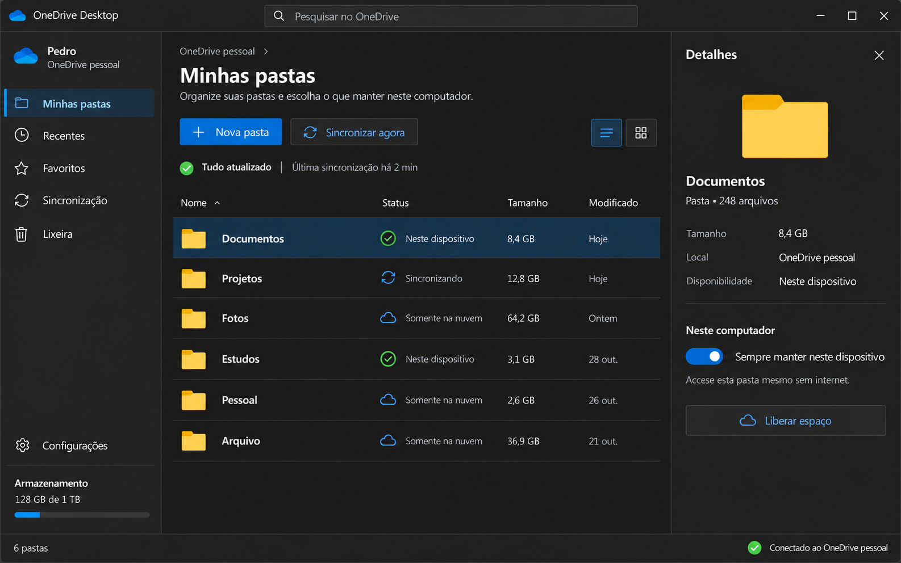

# Onix Desktop

Um aplicativo desktop pessoal para trazer à minha máquina uma experiência de navegação semelhante à do **OneDrive na web**: uma janela completa para visualizar, pesquisar e organizar minhas pastas e consultar seus detalhes.

A motivação é ter um lugar próprio para trabalhar com o OneDrive no desktop, além do acesso pelo ícone na bandeja ou barra de menus. O projeto terá interface própria e pretende aproveitar a sincronização do cliente oficial onde isso for adequado.

O aplicativo também é um projeto de aprendizado: está sendo construído em aulas incrementais para estudar **Python, PySide6, Qt Widgets e customização com QSS**, com atenção à organização do código e à manutenção.

## Estado atual

**Protótipo de interface, versão 0.1.0.** A tela usa dados de exemplo; ainda não autentica uma conta Microsoft nem consulta ou modifica o OneDrive real. O nome “Pedro” e os status das pastas são demonstrativos.

O comando “Nova Pasta” adiciona um objeto apenas à memória da aplicação. As pastas criadas nessa demonstração desaparecem ao fechar o app. A preferência de tema é salva localmente.

### Implementado

- Janela principal com barra superior e pesquisa integrada à área de título.
- Barra lateral com identificação de conta, logotipo do OneDrive e seleção exclusiva de navegação.
- Tabela de pastas com nome, status e tamanho, cabeçalhos alinhados à esquerda e seleção por linha.
- Pesquisa por nome com `QSortFilterProxyModel`, preservando os dados originais.
- Estado vazio quando a pesquisa não encontra pastas.
- Painel de detalhes atualizado pela seleção.
- Criação de pastas de exemplo, com validação de nome vazio e duplicidade.
- Temas claro e escuro, alternância em execução e preferência persistida com `QSettings`.
- Integração nativa no macOS para a barra superior e o alinhamento dos controles da janela.
- Ajustes de análise estática para a ponte dinâmica do PyObjC.

Os itens “Recentes”, “Favoritos”, “Sincronização” e “Lixeira” têm seleção visual, mas ainda não possuem páginas e operações próprias. “Configurações” também não abre uma tela. A interface está em aproximação gradual aos conceitos aprovados.

## Direção visual

A referência escolhida é o **design system Microsoft**, adaptado para um gerenciador desktop pessoal: azul Microsoft, superfícies neutras, hierarquia de textos e cantos discretos. No macOS, mantemos os controles nativos da janela.

A fonte possui alternativas locais quando Segoe UI não está instalada. As imagens abaixo são **conceitos aprovados**, não capturas da implementação atual.

### Conceito claro



### Conceito escuro



## Tecnologias

| Tecnologia | Papel |
| --- | --- |
| Python 3.14+ | Linguagem do projeto. |
| UV | Gerenciamento de dependências, ambiente e execução. |
| PySide6 / Qt Widgets | Interface desktop. |
| QSS | Estilos compartilhados e cores dos temas. |
| QSettings | Preferências locais. |
| PyObjC / Cocoa | Integração da janela no macOS; dependência condicional. |
| Microsoft Graph | Integração futura com o OneDrive; ainda não implementada. |

Python foi escolhido pela experiência prévia do autor e pelo objetivo didático. Os exemplos usam PySide6 de forma consistente.

## Executar

Com o UV instalado, abra um terminal na raiz deste repositório:

```bash
uv sync
uv run python main.py
```

A versão de Python está indicada em `.python-version`. Não é necessário ativar manualmente o ambiente `.venv` para usar `uv run`.

Para adicionar dependências, use `uv add nome-do-pacote`. Mantenha `pyproject.toml` e `uv.lock` no controle de versão; o diretório `.venv` é local.

### Desenvolvimento no Zed

As configurações do projeto ficam em `.zed/settings.json`. Execute `uv sync --locked`
para instalar também as ferramentas de desenvolvimento. No seletor de ambiente Python
do Zed, escolha a `.venv` deste projeto caso ela ainda não esteja selecionada.

- **BasedPyright:** autocomplete, navegação e análise de tipos de todo o projeto,
  usando o ambiente `.venv` e os stubs de PyObjC em `typings`.
- **Ruff:** linting, correções seguras, organização de imports e formatação ao salvar.
  As regras compartilhadas estão em `pyproject.toml`, com Python 3.14 e linhas de 100 caracteres.
- **QSS:** arquivos `.qss` usam o realce de CSS.
- **Terminal:** abre na raiz do projeto e ativa a `.venv` automaticamente.

Abra a paleta de comandos com `Cmd+Shift+P` no macOS (`Ctrl+Shift+P` no Windows)
e procure `task: spawn` para executar o app, sincronizar o ambiente, verificar lint,
formatação e tipos ou rodar os testes. As tarefas ficam em `.zed/tasks.json`.
As tarefas usam a sintaxe de shell do macOS/Linux e acrescentam `~/.local/bin` ao
PATH para localizar o UV instalado pelo instalador oficial. No Windows com
PowerShell, troque o campo `command` das tarefas por `uv` e mantenha o UV no PATH.

As mesmas verificações podem ser executadas no terminal:

```bash
uv run ruff check .
uv run ruff format --check .
uv run basedpyright
uv run python -m unittest discover -s tests -v
```

Para aplicar as correções seguras e formatar manualmente, use `uv run ruff check --fix .`
e `uv run ruff format .`. Arquivos de recursos em `assets` ficam fora do Ruff.
O Ruff não lê `.pylintrc`; esse arquivo continua disponível para uso separado com Pylint.

#### Configurações trazidas do VS Code

A pasta `.vscode` foi preservada. O ambiente Python `.venv` e a ocultação de arquivos
`.pyc`, `__pycache__` e `.pytest_cache` estão representados nas configurações do Zed.
No Zed, a exclusão de `.pyc` é incondicional, pois não há a condição de arquivo irmão
usada pelo `files.exclude` do VS Code.

As opções de extensões do VS Code não são lidas pelo Zed:

- **cSpell:** as palavras `AppKit`, `objc`, `PyObjC`, `NSToolbar` e `NSWindow`
  continuam em `.vscode/settings.json`; este setup não instala um corretor ortográfico no Zed.
- **SQLTools:** a conexão SQLite `sqlite_security_course`, apontando para `./storage.db`
  e com limite de prévia de 50 linhas, continua em `.vscode/settings.json`.
  Este setup não cria uma conexão de banco no Zed. O arquivo `storage.db` não está
  presente no repositório atual.

Referências: [Python no Zed](https://zed.dev/docs/languages/python) e
[tarefas do Zed](https://zed.dev/docs/tasks).

### Plataformas

O objetivo é executar no **macOS e no Windows**. O desenvolvimento e as verificações descritas nesta etapa aconteceram no Mac; o comportamento no Windows ainda precisa de validação na plataforma.

A dependência `pyobjc-framework-cocoa` possui o marcador `sys_platform == 'darwin'`. O adaptador nativo é limitado ao macOS pelo decorator `os_restriction`.

## Organização do código

```text
main.py                         # Inicialização, tema e conexões da aplicação
src/
├── models/
│   └── folder.py                # Dados de uma pasta, sem dependência de Qt
├── services/
│   ├── app_settings.py          # Leitura e gravação da preferência de tema
│   └── onedrive_service.py      # Reservado para a integração futura
├── decorators/
│   └── operational_system_restriction.py
├── platforms/
│   └── macos.py                 # Integração específica com Cocoa
└── ui/
    ├── main_window.py          # Composição das três áreas e da barra superior
    ├── pages/home.py           # Coordenação da página e dos dados de exemplo
    ├── components/             # Blocos compostos da interface
    │   ├── primitive/          # Botões, labels, ícones, divisores e ToggleSwitch
    │   ├── account_header.py
    │   ├── sidebar_navigation.py
    │   ├── storage_usage.py
    │   ├── page_header.py
    │   ├── folder_toolbar.py
    │   ├── view_mode_selector.py
    │   ├── details_header.py
    │   ├── folder_summary.py
    │   └── folder_availability.py
    └── themes/                 # base.py, light.py, dark.py, constants.py e carregador
assets/
├── concept_light.png
├── concept_dark.png
└── icons/                      # Ícones e registros de origem
typings/                       # Descrições locais de tipos do AppKit e objc
```

`src` é atualmente um pacote Python: os imports usam `src.ui...`, e a execução parte de `main.py`. O projeto ainda não configura um pacote instalável com um comando próprio.

### Componentização da interface

`Sidebar` compõe `AccountHeader`, `SidebarNavigation` e `StorageUsage`.
`HomePage` compõe `PageHeader`, `FolderToolbar`, `SyncStatus` e os resultados,
e continua coordenando pesquisa e criação das pastas de exemplo.
`FolderDetails` coordena `DetailsHeader`, `FolderSummary` e `FolderAvailability`;
este último mantém o vínculo entre o switch e a pasta selecionada.

Os elementos básicos ficam em `src/ui/components/primitive`:

- `StyledLabel`: texto, `objectName`, papel QSS, alinhamento e quebra de linha.
- `IconLabel`: carregamento de ícone, dimensões e recoloração.
- `IconButton` e `ActionButton`: tamanho do ícone, acessibilidade, cores dos
  estados normal/selecionado e configuração das ações com texto.
- `NavigationButton`: botão selecionável com indicador lateral.
- `Divider` e `ToggleSwitch`: separadores e controle de alternância.

Os primitivos preservam os controles nativos do Qt. Cores e tipografia continuam
nos temas compartilhados; os componentes mantêm os seletores QSS existentes.
`set_theme()` nos blocos compostos encaminha o tema aos filhos responsáveis pelos
ícones e pelo switch. O `ToggleSwitch` agora é importado de
`src.ui.components.primitive.toggle_switch`.

Os testes em `test_primitives.py`, `test_composed_components.py` e
`test_component_flows.py` cobrem os componentes isolados e sua integração com
criação de pastas, pesquisa, detalhes, navegação e rodapé.

### Fluxos principais

- **Pesquisa:** `TitleBar` → `MainWindow` → `HomePage` → filtro da `FolderTable`.
- **Detalhes:** `FolderTable.folder_selected` → `HomePage.folder_selected` → `FolderDetails`.
- **Tema:** botão da sidebar → janela → `main.py` → `apply_theme` e `AppSettings`.
- **Estilo:** `base.py` define formatos e medidas; `light.py` e `dark.py` definem as cores.
  Os três usam `QSSBuilder` e os tokens de `src/ui/themes/constants.py`. O carregador
  combina o estilo base com o tema escolhido e aplica o QSS gerado à aplicação.

Para ajustar fontes, tamanhos, espaçamentos, bordas ou cores, edite `constants.py`.
As paletas `LightColors` e `DarkColors` usam nomes por função, como `TextSecondary`,
`SurfaceSidebar` e `PrimaryHover`. As medidas já incluem a unidade esperada pelo QSS.
Para visualizar um tema com destaque de sintaxe no terminal:

```bash
uv run python -m src.ui.themes.base
uv run python -m src.ui.themes.light
uv run python -m src.ui.themes.dark
```

## Próximas etapas

1. Continuar o acabamento visual conforme os conceitos: ícones da navegação, toolbar, detalhes, tabela e rodapé.
2. Revisar a limpeza da seleção após filtrar: no código atual, ela ainda ocorre antes de atualizar o filtro; a correção discutida deve limpar a seleção e o índice atual depois da filtragem.
3. Implementar as páginas de navegação e as operações locais de interface.
4. Adicionar autenticação de conta Microsoft pessoal e acesso ao Microsoft Graph.
5. Investigar separadamente disponibilidade offline, liberação de espaço e estado real do cliente de sincronização em cada sistema.
6. Validar a experiência no Windows e preparar o empacotamento.

A sincronização real, a persistência de arquivos e a disponibilidade offline ainda são objetivos futuros. Textos como “Sincronizando” na tabela não representam operações em andamento.

## Aulas e documentação

O percurso cobre janela, layouts, QSS, sidebar, modelos e tabela, sinais, detalhes,
diálogos, temas, preferências, integração nativa, pesquisa e estado vazio. A etapa
atual organiza o protótipo em componentes compostos e primitivos reutilizáveis.

Os relatórios individuais das aulas e a explicação detalhada do projeto foram registrados no vault pessoal do Obsidian, em **Projetos/onix-desktop**. A documentação reflete a conversa e a leitura do código em **01/11/2026**; testes relatados em aulas anteriores não foram integralmente reexecutados nesta atualização documental.

## Identidade e recursos

Projeto independente para uso pessoal e estudo, sem afiliação oficial com a Microsoft. O SVG do OneDrive foi obtido no CDN da Microsoft para corresponder ao conceito aprovado. Sua origem está em `assets/icons/brands/SOURCE.md`.

Os recursos de marca estão separados dos ícones de sistema usados pelo Fluent 2.
Todos os 21.833 SVGs de sistema da revisão oficial fixada ficam em
`assets/icons/fluent/<tamanho>/<variante>/`, incluindo regular, filled, light,
color e versões localizadas. O caminho de 20px usado pela sidebar permanece válido.
Os ícones de produtos ficam em `assets/icons/fluent/launch/` (17 produtos,
338 arquivos), e os de arquivos em `assets/icons/fluent/files/` (93 tipos,
5.001 arquivos). Ambos preservam os formatos e densidades disponíveis no CDN.
O loader pode aplicar cor por tema aos monocromáticos em memória; os ícones
multicoloridos e o logotipo OneDrive mantêm as cores originais.
Origem, revisão e licença estão em `assets/icons/fluent/SOURCE.md`; o inventário
com URLs e checksums fica em `assets/icons/fluent/manifest.json`.
Não se atribui ao projeto uma licença para os logotipos da Microsoft.

## Licença

O código e a documentação originais do projeto estão disponíveis sob a
[licença MIT](LICENSE), com copyright de Pedro Augusto Barbosa Aparecido.
Os recursos de terceiros mantêm seus próprios termos, detalhados em
[THIRD_PARTY_NOTICES.md](THIRD_PARTY_NOTICES.md).
